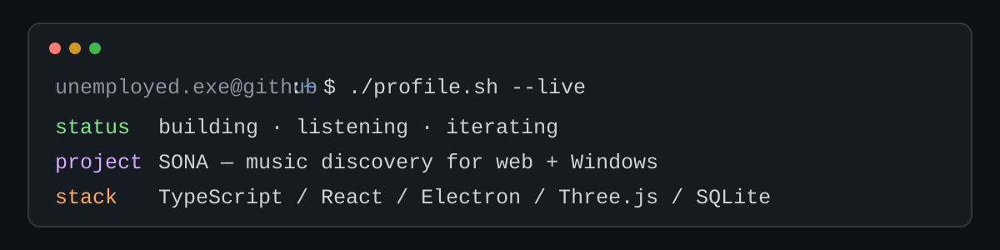
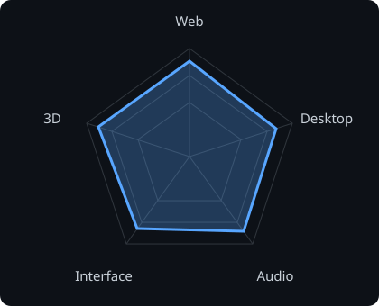
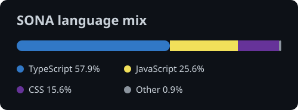

<picture>
  <source media="(prefers-color-scheme: dark)" srcset="banner-dark.svg">
  <source media="(prefers-color-scheme: light)" srcset="banner-light.svg">
  
</picture>

 

 

---

## This is me

I’m **unemployed.exe**, building software where music, interaction, and desktop craft meet.

- **Currently building SONA** — one music experience across the web and Windows.
- **On the web:** music discovery, search, album pages, browser playback, and a tactile 3D collector.
- **On Windows:** an offline-first local library, native audio decoding, playlists, favourites, and desktop media controls.
- **Design focus:** physical album artwork, warm light, responsive glass controls, and one visual language across both surfaces.
- **Current mode:** refining the listening experience, library model, and desktop release flow.

 

## my perfect stack

---

## signals

<table>
<tr>
<td width="50%" align="center" valign="middle">

<picture>
  <source media="(prefers-color-scheme: dark)" srcset="radar-dark.svg">
  <source media="(prefers-color-scheme: light)" srcset="radar-light.svg">
  
</picture>

</td>
<td width="50%" align="center" valign="middle">

<picture>
  <source media="(prefers-color-scheme: dark)" srcset="languages-dark.svg">
  <source media="(prefers-color-scheme: light)" srcset="languages-light.svg">
  
</picture>

</td>
</tr>
</table>

---

## SONA

### A little closer to the music.

| Surface | Foundation |
| --- | --- |
| Web | React 19 · TypeScript · Vite |
| Windows | Electron · SQLite · FFmpeg |
| Visual system | Three.js · React Three Fiber · CSS |
| Verification | Playwright · native library and desktop checks |

The project is currently private while the experience and release workflow are being refined.

---

` Build with music · unemployed.exe `

